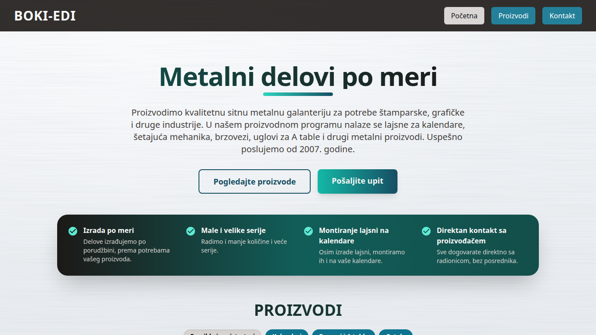

# Boki-Edi website

**Live site: https://www.boki-edi.com**

I built and maintain this site for my family's business.

Boki-Edi is a small metal workshop in Belgrade, Serbia, that makes hardware for calendar printers and folder makers. The site is in real use: the business sends it to customers, and its links are printed on flyers and in QR codes. Its text is in Serbian.



## Tech stack

- **Frontend:** React 18, React Router, Tailwind CSS, built with Vite
- **Build tooling:** Node.js scripts, headless Chrome over the DevTools protocol, sharp
- **Contact form:** EmailJS
- **Hosting:** Vercel, with a move to Netlify prepared

## What was built

- **Pre-rendering for SEO.** The React app is rendered to static HTML at build time and hydrated in the browser, so search engines and link previews get the full content without JavaScript. Each page has its own metadata, plus structured data, a sitemap and a real 404 status. Lighthouse on the live site (mobile, November 2026): Performance 99–100; Accessibility, Best Practices and SEO 100. ([prerender.mjs](scripts/prerender.mjs))
- **PDF catalogue and flyer generator.** One command turns the site's product data into print-ready PDFs with clickable links and vector QR codes. The build refuses a PDF if a text is missing, a page overflows or an unexpected font gets embedded, and `npm run build` warns when a PDF is out of date with its sources. ([make-catalog.mjs](scripts/make-catalog.mjs), [make-flyer.mjs](scripts/make-flyer.mjs), [the catalogue](public/katalog.pdf))
- **Hosting migration with automated checks.** A move from Vercel to Netlify's free plan, prepared so visitors and Google see no change: plain 301 rules keep the old URLs working, and the credit budget is based on measured page weight. A script checks redirects, the 404, MIME types and PDF headers, locally or on any URL; it was validated against the live site and against deliberately broken setups. The switch itself is still to come. ([check-hosting.mjs](scripts/check-hosting.mjs), [the plan](docs/hosting-migration.md))
- **Accessible, stable interface.** Product tabs with ARIA roles and keyboard control, deep links that printed QR codes rely on, no layout shift, and all content readable with JavaScript off. ([Products.jsx](src/sections/Products.jsx))
- **Documented decisions.** A [log of the changes and the reasons](CHANGES.md), and an [SEO audit with a phased plan](docs/seo-audit.md).

Developed with Claude Code as an AI pair programmer, so most commits carry a co-author line. The requirements, decisions and review are mine.

## Run it

Needs Node.js 20 or newer.

```bash
git clone https://github.com/boris-karasek/boki-edi.git
cd boki-edi
npm install
npm run dev      # http://localhost:5173
```

| Command | What it does |
|---|---|
| `npm run build` | Builds and pre-renders the site into `dist/` |
| `npm run preview` | Serves the build with the production redirects and headers |
| `npm run check:hosting` | Runs the hosting checks on a local Netlify server (Node 22.13+) |
| `npm run catalog`, `npm run flyer` | Regenerates the PDFs (needs Google Chrome) |

Only the contact form needs configuration: put an EmailJS public key in `.env` as `REACT_APP_EMAILJS_PUBLIC_KEY`. Everything else works without it.

Maintenance notes, such as how to add a product, are in [docs/development.md](docs/development.md).

## Ownership

The code is published as a portfolio piece. The product photos, product texts, and the Boki-Edi name and logo belong to Boki-Edi and may not be reused without permission. Noto Sans in `scripts/lib/fonts/` is under the SIL Open Font License.
